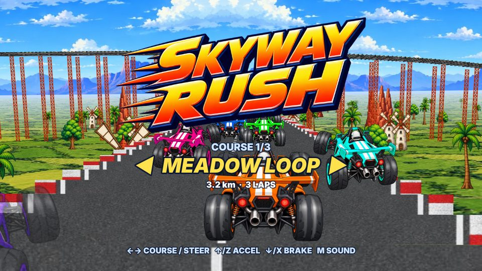
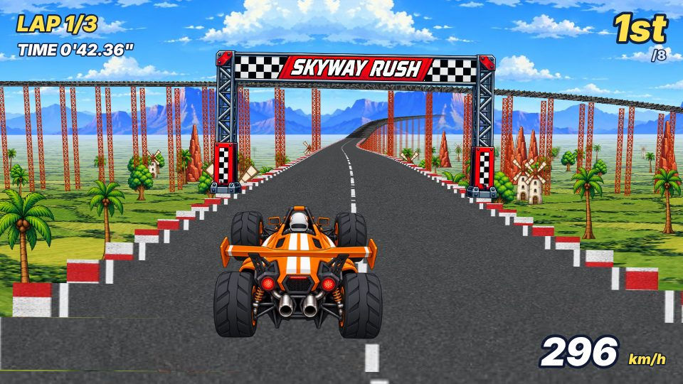
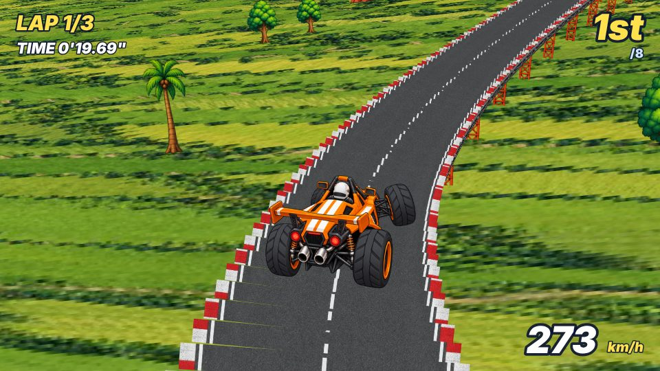
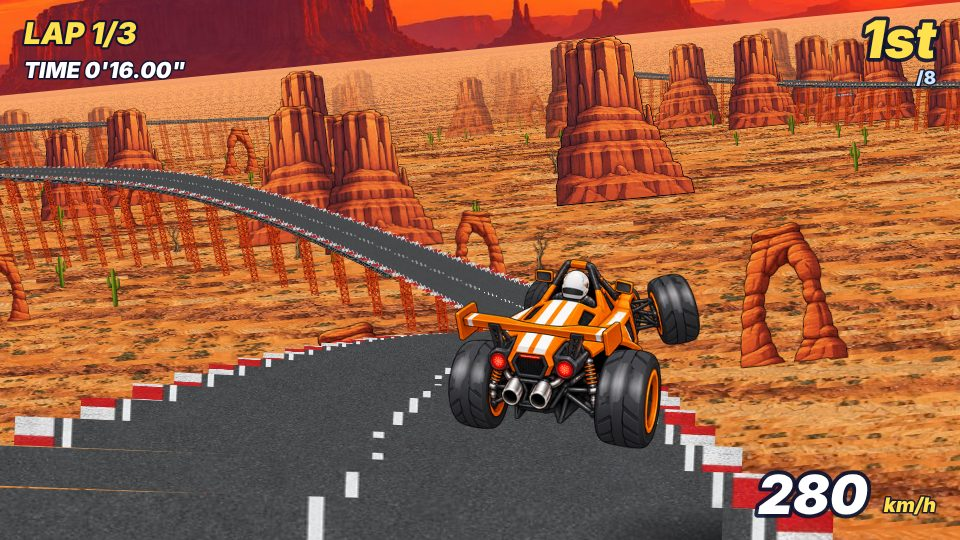
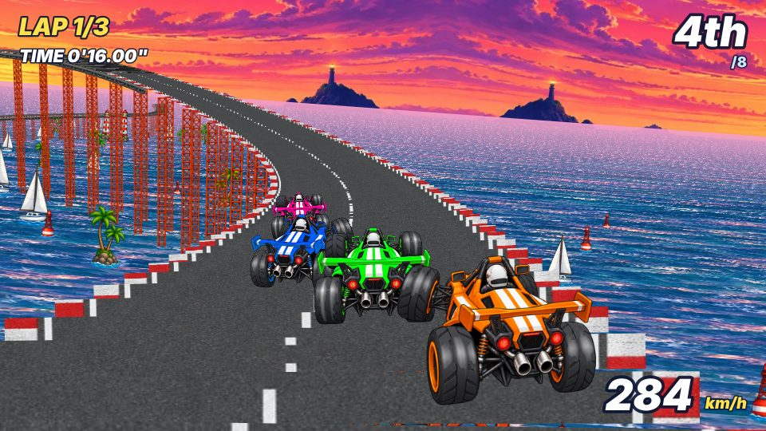
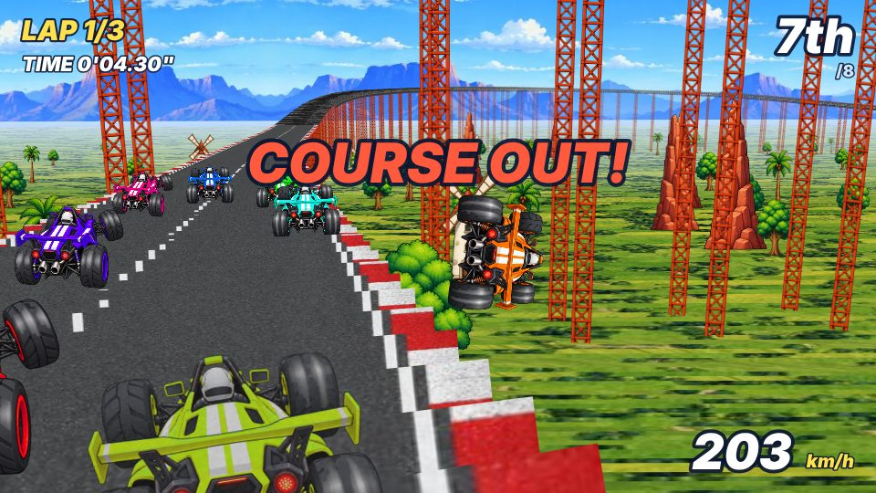

# SKYWAY RUSH（拡大縮小・回転スプライトのレース試作）

80年代後半のアーケードで使われた「スプライトの拡大縮小＋回転だけで3Dに見せる」技法で作った、
ブラウザで動くオリジナルの高架レースゲームです。
特定の既存ゲームの再現ではなく、同じ**技術**を使ったオリジナル作品です
（コース・車・名前・絵はすべて新しく作っています）。

- 絵：OpenAI GPT Image（`gpt-image-2.5-sunburst`、品質 medium）で 18 枚を生成
- プログラム：Claude が JavaScript（Canvas 2D）で作成。ライブラリは使っていません

| タイトル | スタート | ジャンプ |
|---|---|---|
|  |  |  |
| **CANYON RIDGE** | **TWILIGHT BAY** | **コースアウト** |
|  |  |  |

## 遊び方

**ブラウザですぐ遊べます：https://sinme52.github.io/SKYWAY-RUSH/**

手元で動かすときは、リポジトリの直下を静的ファイルとして配信して、`index.html` を開きます。

```bash
python3 -m http.server 8000
```

ブラウザで http://localhost:8000/ を開きます（`file://` で直接開くと画像を読み込めないブラウザがあります）。

| 操作 | キーボード | スマホ（横画面） |
|---|---|---|
| ハンドル | ← → （A / D） | ◀ ▶ |
| アクセル | ↑ / Z / W | A |
| ブレーキ | ↓ / X / S | B |
| コース選択 | タイトルで ← → | タイトルで ◀ ▶ |
| スタート・リトライ | Enter / Space / クリック | A |
| コース選択に戻る | ゴール後に Esc | ゴール後に B |
| 音のオン・オフ | M | — |

3 コースから選び、8 台で 3 周するレースです。丘の頂上を速いスピードで越えると車が宙に浮きます。
急なカーブは遠心力で外側へ流されるので、ブレーキを使って曲がります。
勢いよく路肩を越えるとコースから飛び出し、回転しながら落ちていきます。地面（立体交差では下を通る道路）に落ちた時点で「COURSE OUT」となり、1 秒後に落ちた地点のコース中央へ点滅しながら戻ります
（点滅中はほかの車とぶつかりません）。
敵の車も同じ仕組みで落ちます。敵はきついカーブの手前で、ときどき減速しそこなって曲がりきれずに落ちます。
路肩寄りを走る敵に横から勢いよくぶつかると、外へ押し出して落とすこともできます（逆に押し出されることもあります）。

| コース | 全長 | 特徴 |
|---|---|---|
| 1. MEADOW LOOP | 3.2km | 青空と田園。8の字で立体交差あり。急な上り坂と丘のジャンプ |
| 2. CANYON RIDGE | 2.5km | 夕焼けの峡谷。S 字と大きな落差のジャンプ、谷底すれすれのくぼみ |
| 3. TWILIGHT BAY | 2.7km | 夕暮れの海。左へ 270 度回り込んで自分の走った道の上を越える |

URL に `?course=2` のように付けると、そのコースで始まります。`?autopilot` を付けると自動運転で走ります（動作確認用）。
各コースの最速タイムは、そのブラウザに保存されます。

## 「拡大縮小と回転だけ」で描く仕組み

画面に出る物体はすべて、画像を `setTransform(拡大縮小×回転)` してから `drawImage` で描いています。
ポリゴン、台形の変形、せん断変形は使っていません。

| 物体 | 描き方 |
|---|---|
| 路面 | コースを 2m ごとに区切り、各区間の左右の端を画面に投影する。道路テクスチャの横帯（2m ぶん）を「左右の端の距離」の幅に拡大し、「左右の端を結ぶ線」の角度に回して置く。これを奥から順に約 1,600 本重ねる |
| 橋桁（側面と裏側） | 路面の横から見える区間だけ、鉄骨テクスチャの縦帯を同じ方法で置く。カメラが路面より下にあるときは、路面の代わりに裏側を描く |
| 鉄塔 | 鉄塔の画像を地面までテクスチャ1枚ぶんずつ縦に並べる（伸ばさずに並べるので、トラスの目の大きさが揃う） |
| 木・岩・風車・車 | 足元を投影し、距離に反比例して拡大する。カメラの傾きに合わせて回す |
| 車の向き | 「真後ろ」「斜め後ろ」の 2 枚と、その左右反転（`scale(-1, 1)`）で 3 方向を表す。色違いの 7 台は、起動時にオレンジ部分の色相だけを回して作る |
| タイヤの回転 | 向きごとに「通常」「溝が少し進んだ絵」「高速回転のぶれ」の 3 コマ。低速では前の 2 コマを走った距離に合わせて交互に出し、速くなると回転ぶれの絵にする |
| コースアウト | 車をコースの外へ放り出して重力で落とし、画像を回転させながら「真後ろ→斜め→斜めの反転」と絵を切り替えて回って見せる。落下中はカメラが道路の外へ出て、斜め後ろ上から車を追う |
| 空 | 1 枚の横長の画像を、反転した画像と交互に並べて継ぎ目をなくし、カメラの向きに合わせて横にずらす |
| 地面 | 地面テクスチャの1行を横長に引き伸ばした帯を、地平線から手前へ距離に応じて並べる |
| カメラの傾き | カーブで路面がバンクすると、画面全体が傾く。空と地面は、画面中心を軸に回した座標系で描く |

奥行きは「遠い物から順に描く」だけで表しています（Zバッファなし）。
コースは 16 個の制御点を通る 3D スプラインで、全長は約 3.2km、高低差は約 50m です。
最も高い所では路面が地面から 58m あり、立体交差の上下の差は約 26m です。

## ファイル

```
index.html               画面とスマホ用のボタン
game.js                  描画・物理・AI・音・HUD
track.js                 3 コースの制御点とスプライン（Node からも読める）
assets/*.png, *.jpg      ゲームで使う画像（tools/process_assets.py の出力）
assets/raw/              GPT Image が出力した原画と、生成時のプロンプト（.json）
tools/process_assets.py  原画の切り出し・縮小（Pillow）
tools/check.mjs          Playwright で 3 コースを自動走行させ、スクリーンショット・完走結果・コースアウトからの復帰を確認する
tools/track_report.js    コースの最小半径・勾配・ジャンプ台・立体交差の高低差を表示する
```

## 生成した画像

| ファイル | 内容 | サイズ | 生成時間 |
|---|---|---|---|
| car_rear | 車（真後ろ、透過） | 1024×1024 | 16秒 |
| car_turn | 車（斜め後ろ。car_rear を参照画像にした edit） | 1024×1024 | 19秒 |
| sky | 空と遠くの山（横長） | 2304×768 | 12秒 |
| road | 真上から見た道路（縦につながる） | 1024×1024 | 13秒 |
| deck | 橋桁の側面（横につながる） | 1536×512 | 11秒 |
| pillar | 鉄塔（透過、縦につながる） | 512×1536 | 12秒 |
| ground | 真上から見た田園（つながる） | 1024×1024 | 18秒 |
| scenery | ヤシ・広葉樹・岩・風車の4点（透過、1枚から切り出し） | 1536×1024 | 16秒 |
| gate | スタートゲート（透過） | 1536×768 | 11秒 |
| logo | タイトルロゴ（透過） | 1536×768 | 13秒 |
| car_rear_spin / car_turn_spin | タイヤだけ回転ぶれにした車（元の車を参照画像にした edit） | 1024×1024 | 20秒 / 17秒 |
| sky_canyon / ground_canyon | 夕焼けの空と峡谷の地面 | 2304×768 / 1024×1024 | 15秒 / 20秒 |
| scenery_canyon | サボテン・岩のアーチ・メサ・枯れ木 | 1536×1024 | 16秒 |
| sky_bay / ground_bay | 夕暮れの空と海 | 2304×768 / 1024×1024 | 13秒 / 16秒 |
| scenery_bay | 灯台・ヨット・ヤシの小島・ブイ | 1536×1024 | 17秒 |

タイヤが回る絵は、生成された画像をそのまま使うと車体が少しずれてちらつきます。
そのため `tools/process_assets.py` で元の絵と位置を合わせてから、タイヤだけを差し替えています。
タイヤは「元の絵で暗く大きな塊のうち、生成した絵で大きく描き変わった塊」として選び、塊ごとまるごと差し替えます
（描き変わった画素だけを差し替えると、溝の模様が似た所が漏れて、そのタイヤだけ止まって見えるため）。
`TIRE_DEBUG_DIR=<フォルダ> python3 tools/process_assets.py` とすると、選んだタイヤを赤く塗った確認画像を書き出します。

プロンプトは `assets/raw/*.json` にあります。原画から作り直すときは次を実行します。

```bash
python3 tools/process_assets.py
```

## 確認したこと

`node tools/check.mjs <出力フォルダ>` で、ヘッドレスの Chromium を使って次を確認しました。

- 3 コースとも、カウントダウン → 3 周 → ゴールまで自動運転でエラーなく完走した（MEADOW LOOP 約 2 分 02 秒、CANYON RIDGE 約 1 分 41 秒、TWILIGHT BAY 約 1 分 44 秒）
- 丘を越えるときに車が宙に浮き、路面に影が出る（3 周で合計 2〜4 秒）
- 路肩を勢いよく越えると落下し、地面に着くまでは COURSE OUT にならない。高さ 19.9m から落ちた場合、1.63 秒後に地面で COURSE OUT となり、その 1.0 秒後にコース中央へ戻って 2.2 秒点滅し、その後ふつうに走れる
- 立体交差の上の道から下の道の真上に落とすと、下の道の高さ（MEADOW LOOP 19.5m、TWILIGHT BAY 10.2m）で止まり、そこで COURSE OUT になる
- 敵が落ちる回数は、自動運転で各コース 4 レースずつ走らせた平均で、1 レースあたり 2.25 回（MEADOW LOOP）、4.25 回（CANYON RIDGE）、2.75 回（TWILIGHT BAY）。自動運転のプレイヤーは 12 レースで 1 回も落ちなかった
- 路肩寄りの敵に横から体当たりすると、敵が押し出されて落ちる
- 立体交差では、上下の道路が正しい順で重なる。下の道路には鉄塔を立てない
- iPhone 13 の横画面を模した表示で、タッチボタンを押すとレースが始まり、HUD とボタンが重ならない
- 1 フレームに描く画像は 300〜1,900 枚程度

ヘッドレス環境は GPU を使わないソフトウェア描画で、約 30fps でした。GPU のある普通のブラウザでの fps は測っていません。

## 今後の改善案

- 路面の継ぎ目が、近くでは段々に見える（スプライトを重ねる技法の特徴でもある）
- 車の向きは 3 方向だけなので、急カーブでは向きの切り替わりが目立つ。8 方向ぶん生成すると滑らかになる
- 敵が落ちる頻度は `game.js` の `AI_MISTAKE_CHANCE`（きついカーブ 1 つ・1 台あたりの確率）で変えられる
